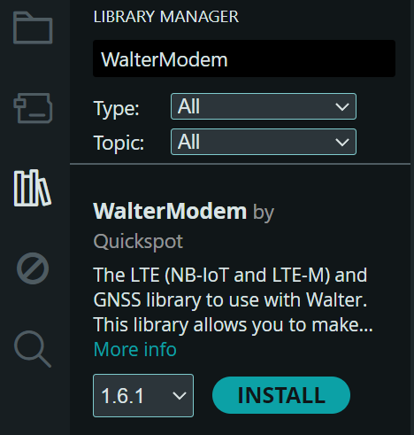
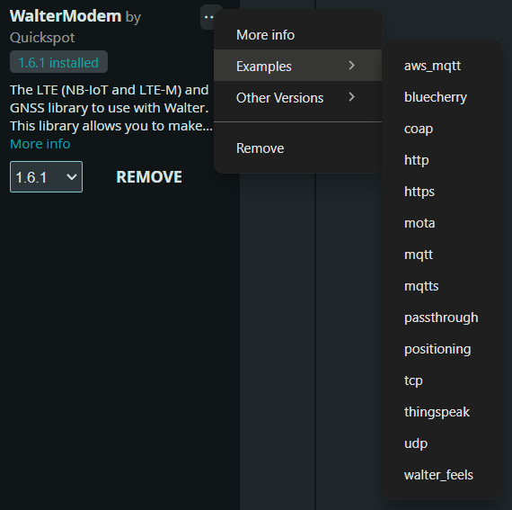

## Introduction

This guide will walk you through installing the Walter Modem library,
selecting the right board settings,
and running example sketches to get your modem up and running.

> [!TIP]    
> If you haven't set up the Arduino IDE yet,
> go through [Arduino Setup Guide](/developer-toolchains/arduino.md) first.

## Guide

### 1. Installing the Walter Modem Library

The Walter modem library can be easily installed
via the built-in Arduino Library Manager:

1. Open the Arduino IDE.
2. Navigate to **Tools > Manage Libraries…**
3. In the search field, type `WalterModem`.
4. Select the Walter modem library from the list and click **Install**.



### 2. Opening and Running an Example

Once the library is installed, you can explore the provided examples:

1. Open the **Library Manager** in the Arduino IDE.
2. Search for **WalterModem** and select it.
3. Click on the **three dots** in the upper right corner.
4. Hover over **Examples**, then choose one from the list.
5. The selected example will open in a new sketch window.



### 3. Board Selection and Configuration

Before uploading your sketch,
ensure that your board is properly selected and configured:

1. Click the board selection button in the top left corner of the Arduino IDE.
2. In the search bar, type `DPTechnics Walter` and select the board.

   

   

3. Ensure the partition scheme under **Flash Size** is set to:
   (2MB APP/12.5MB FATFS), this is required to allow modem firmware updates.

### 4. Running the Sketch

With the board configured and the example open:

1. Click the **Upload** button in the Arduino IDE.
2. Wait for the sketch to compile and upload to the board.
3. Open the Serial Monitor to view output
   and confirm that the modem connects to the internet.

#### Example code
      
> [!NOTE]       
> This example only talks to the modem itself, so it works without a SIM card or network connection.

```cpp
#include <Arduino.h>
#include <HardwareSerial.h>
#include <WalterModem.h>
#include <esp_chip_info.h>
#include <esp_mac.h>

HardwareSerial ModemSerial(2);
WalterModem modem;

/* Print general information about the ESP32, the Arduino core and this sketch. */
static void printSystemInfo()
{
  Serial.printf("Sketch built %s %s\n", __DATE__, __TIME__);
  Serial.printf("Arduino-ESP32 core: %d.%d.%d, ESP-IDF version: %s\n", ESP_ARDUINO_VERSION_MAJOR,
                ESP_ARDUINO_VERSION_MINOR, ESP_ARDUINO_VERSION_PATCH, ESP.getSdkVersion());

  esp_chip_info_t chip;
  esp_chip_info(&chip);
  Serial.printf("Chip: %s rev v%d.%d, %d CPU core(s), %s%s%s\n", ESP.getChipModel(),
                chip.revision / 100, chip.revision % 100, chip.cores,
                (chip.features & CHIP_FEATURE_WIFI_BGN) ? "WiFi " : "",
                (chip.features & CHIP_FEATURE_BLE) ? "BLE " : "",
                (chip.features & CHIP_FEATURE_EMB_PSRAM) ? "embedded PSRAM" : "");

  Serial.printf("Flash: %lu MB %s\n", (unsigned long) (ESP.getFlashChipSize() / (1024 * 1024)),
                (chip.features & CHIP_FEATURE_EMB_FLASH) ? "embedded" : "external");

  uint8_t mac[6];
  if(esp_read_mac(mac, ESP_MAC_WIFI_STA) == ESP_OK) {
    Serial.printf("MAC: %02x:%02x:%02x:%02x:%02x:%02x\n", mac[0], mac[1], mac[2], mac[3], mac[4],
                  mac[5]);
  }

  Serial.printf("Heap: %lu bytes free (minimum ever %lu), PSRAM: %lu bytes\n",
                (unsigned long) ESP.getFreeHeap(), (unsigned long) ESP.getMinFreeHeap(),
                (unsigned long) ESP.getPsramSize());
}

/* Print the modem's identity numbers. Works without a SIM or network. */
static void printModemInfo()
{
  WalterModemRsp rsp = {};
  if(modem.getIdentity(&rsp) && rsp.type == WALTER_MODEM_RSP_DATA_TYPE_IDENTITY) {
    Serial.printf("Modem IMEI: %s, IMEISV: %s, SVN: %s\n", rsp.data.identity.imei,
                  rsp.data.identity.imeisv, rsp.data.identity.svn);
  } else {
    Serial.println("Could not read the modem identity");
  }
}

void setup()
{
  Serial.begin(115200);
  delay(2000);

  WalterModemRsp rsp = {};
  Serial.println("Testing Arduino and the Walter Modem");
  printSystemInfo();

  Serial.println("Initializing modem...");
  if(!modem.begin(&ModemSerial)) {
    Serial.println("Failed to initialize modem.");
    return;
  }
  Serial.println("Modem initialized successfully.");
  printModemInfo();

  /* Enable temperature monitoring */
  if(modem.configTemperatureMonitor(WALTER_MODEM_TEMP_MONITOR_MODE_ON)) {
    Serial.println("Successfully enabled temperature monitoring");
  } else {
    Serial.println("Could not enable temperature monitoring");
  }

  /* Get temperature reading */
  if(modem.getTemperature(&rsp)) {
    if(rsp.type == WALTER_MODEM_RSP_DATA_TYPE_TEMPERATURE) {
      Serial.printf("Current temperature: %d°C (status: %d)\n", rsp.data.temperature.temperature,
                    rsp.data.temperature.status);
    }
  } else {
    Serial.println("Could not get temperature reading");
  }

  /* Disable temperature monitoring */
  if(modem.configTemperatureMonitor(WALTER_MODEM_TEMP_MONITOR_MODE_OFF)) {
    Serial.println("Successfully disabled temperature monitoring");
  } else {
    Serial.println("Could not disable temperature monitoring");
  }
}

void loop()
{
  delay(1000);
}
```

## Additional Resources

- **Library Source Code:**
  [GitHub Repository](https://github.com/QuickSpot/walter-arduino)
